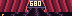
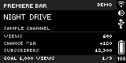

# Premiere Bar

**English** · [Русский](README.ru.md)

A pixel-art cinema for BUSY Bar that fills as your YouTube videos gain views. Turn the wheel to pick a video, watch the curtains open, and see amber seats light up as it approaches your goal.


Built for the [BUSY JS Apps Contest](https://busy.app/pages/js-apps-contest).

## How it works

The **72 × 16 front display** shows a view counter above a 20-seat cinema. Each seat lights up when the video reaches another twentieth of your goal. At the default goal of 1,000 views, that’s one seat for every 50 views. When the hall fills, sparks flash around the screen.

The **160 × 80 rear display** shows the video title, view count, change over roughly one hour, and the channel's public subscriber count. The hourly change appears once the app has a reading from roughly an hour earlier. [YouTube Data API](https://developers.google.com/youtube/data/reference/rest/v3).

## Modes and controls

- **LIVE** shows up to five recent public videos from your channel. Premiere Bar checks YouTube every five minutes and can show the last saved figures for up to 24 hours if the connection drops.
- **DEMO** lets you try three sample videos immediately. The rear display shows **DEMO** and the front display has an amber marker.

| Control | Action |
| --- | --- |
| **Turn the wheel** | Switch videos. |
| **Start / Pause** | Replay the curtain opening. |
| **OK** | Request a refresh. In demo mode, add views or reset a full cinema. |
| **Back** | Exit the app. |

## Scene gallery

All frames were captured in the official BUSY Bar Emulator.

| Scene | Display |
| --- | :---: |
| **Curtain opening**<br>The curtains part to reveal the view count. |  |
| **First views**<br>The first few seats light up. |  |
| **Partly filled**<br>More seats light up as the video gains views. |  |
| **Sold out**<br>All 20 seats are lit when the video meets its goal. |  |
| **Rear dashboard**<br>Video and channel statistics beside the view goal. |  |

## Settings

Open **Apps → Premiere Bar → Setup** in your BUSY Bar's local web interface. Save your changes and restart the app. [Open local emulator settings](http://127.0.0.1:8640/).

| Setting | Options |
| --- | --- |
| **YouTube channel** | Enter an `@handle`, a channel ID, or a YouTube channel URL. |
| **YouTube Data API key** | Enable YouTube Data API v3 in your Google Cloud project, create an API key, and restrict it to that API. [Google's setup guide](https://developers.google.com/youtube/v3/getting-started). |
| **Views to fill the cinema** | Choose a goal from 20 to 1,000,000,000 views. The default is 1,000. The same goal applies to each video. |

Premiere Bar sends the channel identifier and API key to Google over HTTPS. YouTube provides the public subscriber count at its published precision. [Subscriber count reference](https://developers.google.com/youtube/data/reference/rest/v3/channels#statistics.subscriberCount) · [Privacy notice](PRIVACY.md).

## Build and run

Use Node.js **22.12 or later** and start the [official BUSY Bar Emulator](https://github.com/busy-app/busybar-emulator).

```sh
npm ci
npm test
npm run build
npm run app:install -- --addr 127.0.0.1:8640
npm run app:run -- --addr 127.0.0.1:8640
```

The build produces `dist/app.premierebar.cinema.tgz`. You can also upload this package through your BUSY Bar's web interface. Connect the device to Wi-Fi to fetch YouTube statistics. Both displays and the controls are available on the [emulator page](http://127.0.0.1:8640/emulator).
