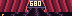
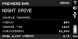

# Premiere Bar

[English](README.md) · **Русский**

Пиксельный кинозал для BUSY Bar, который заполняется по мере роста просмотров твоих видео на YouTube. Поверни колёсико, чтобы выбрать ролик. Занавес откроется, а кресла будут загораться по мере приближения к цели.


Проект создан для хакатона [BUSY JS Apps Contest](https://busy.app/pages/js-apps-contest).

## Как это работает

Передний экран **72 × 16** показывает число просмотров и зал на 20 мест. Каждое кресло загорается, когда ролик набирает ещё одну двадцатую от цели. При цели в 1 000 просмотров это одно кресло за каждые 50 просмотров. Когда зал заполняется, по краям экрана вспыхивают искры.

На заднем экране **160 × 80** видны название ролика, просмотры, изменение примерно за час и публичное число подписчиков канала. Изменение за час появляется, когда у приложения есть показание примерно часовой давности. [YouTube Data API](https://developers.google.com/youtube/data/reference/rest/v3).

## Режимы и управление

- **LIVE** показывает до пяти недавних публичных роликов выбранного канала. Premiere Bar проверяет данные каждые пять минут. При потере связи приложение может показывать сохранённые данные возрастом до 24 часов.
- **DEMO** позволяет сразу попробовать три демонстрационных ролика. На заднем экране видна надпись **DEMO**, а на переднем горит жёлтый маркер.

| Управление | Действие |
| --- | --- |
| **Поворот колёсика** | Переключить ролик. |
| **Start / Pause** | Повторить открытие занавеса. |
| **OK** | Запросить обновление. В демо добавить просмотры или обнулить заполненный зал. |
| **Back** | Выйти из приложения. |

## Галерея сцен

Все кадры сняты в официальном эмуляторе BUSY Bar.

| Сцена | Экран |
| --- | :---: |
| **Открытие занавеса**<br>Занавес раздвигается и открывает счётчик просмотров. |  |
| **Первые просмотры**<br>Загораются первые кресла. |  |
| **Зал заполняется**<br>Чем больше просмотров, тем больше горящих кресел. |  |
| **Аншлаг**<br>При достижении цели горят все 20 кресел. |  |
| **Задний экран**<br>Статистика ролика и канала, а также цель по просмотрам. |  |

## Настройки

Открой **Apps → Premiere Bar → Setup** в локальном веб-интерфейсе BUSY Bar. Сохрани настройки и перезапусти приложение. [Открыть локальные настройки эмулятора](http://127.0.0.1:8640/).

| Настройка | Что указать |
| --- | --- |
| **YouTube channel** | `@handle`, ID или ссылку на канал YouTube. |
| **YouTube Data API key** | Включи YouTube Data API v3 в своём проекте Google Cloud, создай ключ и ограничь его этим API. [Инструкция Google](https://developers.google.com/youtube/v3/getting-started). |
| **Views to fill the cinema** | Цель от 20 до 1 000 000 000 просмотров. По умолчанию 1 000. Цель одинакова для каждого ролика. |

Premiere Bar отправляет идентификатор канала и ключ в Google по HTTPS. Число подписчиков отображается с той точностью, с которой YouTube публикует данные. [Справка о числе подписчиков](https://developers.google.com/youtube/data/reference/rest/v3/channels#statistics.subscriberCount) · [Уведомление о конфиденциальности](PRIVACY.md).

## Сборка и запуск

Установи Node.js **22.12 или новее** и запусти [официальный эмулятор BUSY Bar](https://github.com/busy-app/busybar-emulator).

```sh
npm ci
npm test
npm run build
npm run app:install -- --addr 127.0.0.1:8640
npm run app:run -- --addr 127.0.0.1:8640
```

После сборки в `dist/` появится пакет `app.premierebar.cinema.tgz`. Его можно загрузить через веб-интерфейс устройства. Чтобы получать статистику YouTube, подключи BUSY Bar к Wi-Fi. Оба дисплея и кнопки доступны на [странице эмулятора](http://127.0.0.1:8640/emulator).
